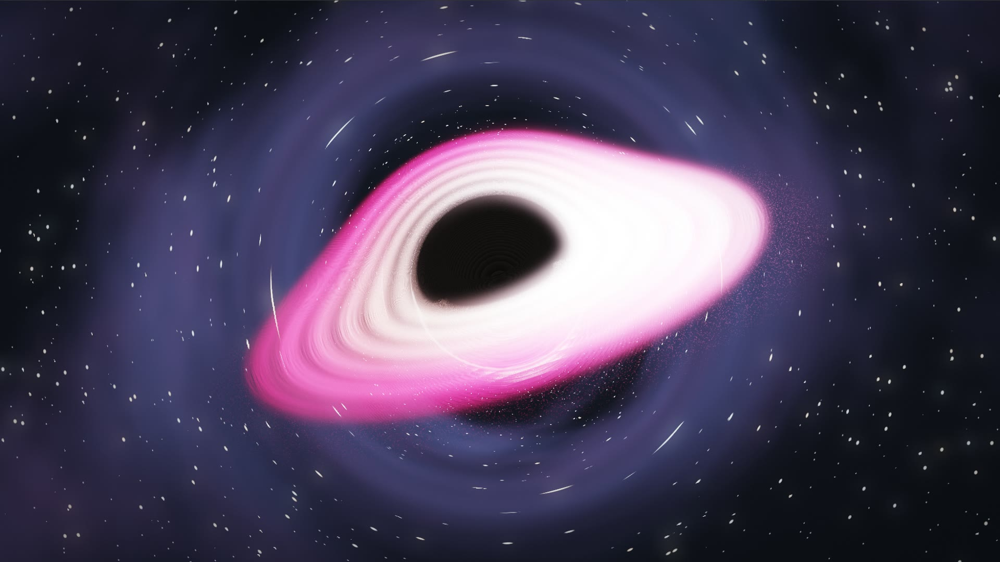
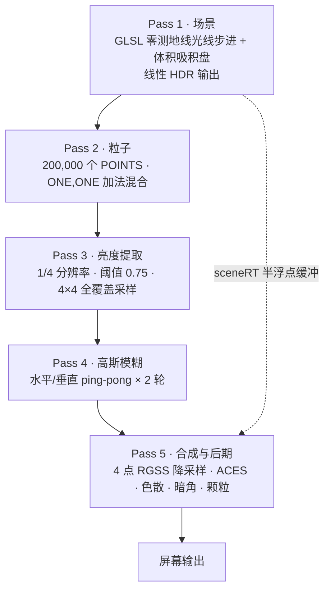

# Gargantua 3D · 广义相对论黑洞实时可视化

一个**单文件、零外部依赖**的 WebGL 实时黑洞渲染器。逐像素积分史瓦西时空零测地线，融合体积流体吸积盘与 20 万颗开普勒轨道粒子，经由半浮点 HDR、多级泛光与 RGSS 超采样管线输出电影级画面，并支持 LCh 无缝色彩循环与桌面壁纸模式。

> 直接打开 `index.html` 即可运行，无需打包工具、外部库或网络连接。

**[▶ 在线预览](https://blycr.github.io/blackhole-3d/)** · **[🖼 壁纸模式（无 UI）](https://blycr.github.io/blackhole-3d/?wallpaper=1)**



<p align="center"><em>自动渐变「品红」相位 · 1920×1080 实机截图</em></p>

---

## 目录

- [核心特性](#核心特性)
- [快速开始](#快速开始)
- [交互与参数](#交互与参数)
- [渲染管线与物理模型](#渲染管线与物理模型)
- [代码与仓库结构](#代码与仓库结构)
- [版本历史](#版本历史)
- [兼容性与已知限制](#兼容性与已知限制)
- [许可证](#许可证)

---

## 核心特性

| 模块 | 实现要点 |
| :--- | :--- |
| **引力透镜与视界阴影** | 逐像素半隐式欧拉积分史瓦西零测地线，自然呈现黑洞背面吸积盘被弯曲抬升的上下双弧；事件视界（`rs = 1`）内输出纯黑阴影，光子球附近形成细锐光子环 |
| **流体 + 粒子混合吸积盘** | 极坐标体积密度场（3 层噪声与尘埃暗带）叠加 200,000 颗开普勒螺旋内落粒子，兼顾物理正确的透镜光环与颗粒物质感 |
| **相对论多普勒效应** | 按切向速度与视线夹角调制 beaming 亮度（指数 `2.2`）与冷暖色移 |
| **HDR + 多级泛光** | 半浮点离屏缓冲（`OES_texture_half_float`，不支持时自动回退 8bit）+ 1/4 分辨率 4×4 全覆盖亮度提取 + 双轮可分离高斯模糊 |
| **电影后期与 RGSS 抗锯齿** | 4 点旋转网格（RGSS）超采样降采样、ACES 色调映射、泛光径向色散、暗角与防溢出胶片颗粒 |
| **LCh 无缝色彩循环** | 卡冈图雅金橙 / 蓝巨星 / 深渊紫 + 6 关键帧 LCh 感知空间无缝渐变，UI 强调色实时联动 |
| **壁纸级长时稳定性** | 帧增量积分旋转与内落相位、角度定期回卷、休眠/切后台防误降级、`webglcontextlost` 自动恢复、配置本地持久化 |

---

## 快速开始

### 1. 在线预览

- 交互模式：<https://blycr.github.io/blackhole-3d/>
- 纯画面壁纸模式：<https://blycr.github.io/blackhole-3d/?wallpaper=1>

由 GitHub Actions 自动构建并托管于 GitHub Pages，所有计算均在本地 GPU 上完成。

### 2. 本地运行

- **直接打开**：双击仓库根目录下的 [`index.html`](index.html) 即可在浏览器运行。
- **局域网 HTTP 服务**：

```bash
python -m http.server 8080
```

随后访问 `http://localhost:8080/`（或使用局域网 IP 供其他设备访问）。

### 3. URL 参数定制

可通过查询参数直接覆盖默认参数或持久化配置，便于壁纸启动或链接分享：

| 参数 | 取值示例 | 说明 |
| :--- | :--- | :--- |
| `wallpaper` | `1` | 隐藏全部 UI（含右上角按钮并禁用交互热区），开启纯画面模式 |
| `theme` | `0` ~ `3` | `0` 卡冈图雅 / `1` 蓝巨星 / `2` 深渊紫 / `3` 自动渐变 |
| `quality` | `auto` / `ultra` / `balanced` / `eco` | 对应 自动 / 极致 2x / 均衡 1.4x / 省电 1x |
| `roll` | `-70` ~ `70` | 画面滚转角度（默认 `-18`） |
| `cycle` | `20` ~ `300` | 自动渐变循环周期（秒，默认 `60`） |

示例：`?wallpaper=1&theme=3&quality=ultra&roll=-18&cycle=60`

### 4. 导入 Wallpaper Engine

1. 复制单文件 [`index.html`](index.html) 到本地目录（或填本地/在线 URL）。
2. 在 Wallpaper Engine 中选择 **创建壁纸 → Web / 网页**，指向该文件或带 `?wallpaper=1` 的地址。
3. 壁纸属性建议：缩放模式选「填充」，非交互壁纸可关闭鼠标输入。

---

## 交互与参数

### 视角与快捷键

- **旋转 / 缩放**：鼠标左键或单指拖拽旋转视角；滚轮或双指缩放视距（`3.6 ~ 22.0`）。
- **空闲淡出**：普通模式下 6 秒无操作会自动收起 HUD 与面板，移动鼠标或按键恢复；点击「隐藏 UI」后仅保留右上角悬停唤出热区。
- **快捷键**：
  - `H`：隐藏 / 显示界面（壁纸模式下锁定隐藏）
  - `Space`：暂停 / 开启自动环绕巡航
  - `R`：重置视角与倾斜角

### 控制面板

所有调节项会自动保存至浏览器 `localStorage`：

| 控件 | 范围 | 默认 | 说明 |
| :--- | :--- | :--- | :--- |
| 吸积粒子浓度 | `0.00 ~ 1.80` | `1.00` | 粒子整体亮度权重，设为 `0` 可单独观察纯流体盘 |
| 气体流体浓度 | `0.00 ~ 1.50` | `0.80` | 流体盘体积密度，设为 `0` 则只保留粒子 |
| 泛光强度 | `0.00 ~ 2.50` | `1.10` | Bloom 叠加权重 |
| 画面倾斜 | `-70° ~ +70°` | `-18°` | 相机绕视线轴滚转角，形成对角构图 |
| 引力弯曲强度 | `0.20 ~ 1.80` | `1.00` | 测地线引力加速度系数，`1.00` 为标准史瓦西值 |
| 吸积盘转速 | `0.00x ~ 3.00x` | `1.00x` | 同时驱动流体与粒子转速（基于增量相位积分，调速平滑无跳变） |
| 多普勒亮暗偏移 | `0.00 ~ 1.20` | `0.75` | 相对论 beaming 与冷暖色移强度，`0` 为关闭 |
| 吸积盘色温 | 4 选 1 | 卡冈图雅 | 三个静态主题 + 自动渐变（面板强调色实时同步） |
| 色彩循环周期 | `20s ~ 300s` | `60s` | 仅「自动渐变」模式可用，静态主题下自动置灰 |
| 超采样画质 | 4 选 1 | 自动 | `自动` / `极致 2x` / `均衡 1.4x` / `省电 1x` |
| 自动环绕巡航 | 开 / 关 | 开 | 相机缓慢自转 |

---

## 渲染管线与物理模型

### 管线总览



### 关键技术细节

1. **史瓦西零测地线积分**
   在几何单位制（$r_s = 1$）下，光子轨道方程在笛卡尔坐标中等价于：
   $$\vec{a} = -\frac{3}{2}\,h^2\,\frac{\vec{r}}{r^5},\qquad h^2 = |\vec{r}\times\vec{v}|^2$$
   角动量平方 $h^2$ 沿光线守恒，仅在步进起点计算一次。步长按半径自适应加密（近视界最小 `0.022`，赤道盘面限制 `≤ 0.045`），光线离开盘区并向外逃逸（`r > diskOuter + 1.5` 且 `dot(pos, vel) > 0`）后步长放宽至 `1.4`，至 `r > 22.0` 逃逸采样背景星空。`photonRing` 仅作用于未被吞噬的掠射光线，保证视界阴影纯黑。

2. **体积吸积盘与早退优化**
   吸积盘分布于 `1.55 < r < 7.0` 的薄壳内，厚度随半径线性增长。步进进入壳层后先评估几何衰减 `baseDensity`；低于截断阈值时直接跳过极坐标三角函数、4 层 `fbm` 与高频/尘埃 `noise3` 计算，命中有效区域再执行步长无关的均匀介质吸收-发射积分。

3. **20 万颗开普勒内落粒子**
   每颗粒子仅占 `vec4 aSeed`（16 字节），位置与颜色全在顶点着色器完成：角速度 $\omega \propto r^{-1.2}$、螺旋内落相位在 CPU 侧按帧积分并对 `1.0` 取模。黑洞背面与视界投影半径 `bProj < 1.30` 的粒子直接剔除，其余背面粒子通过 `smoothstep(bhDist - 0.6, bhDist + 1.2, zCam)` 平滑过渡径向引力透镜推升。

4. **HDR、泛光与 RGSS 超采样**
   - 亮度提取使用 `±1.0` 场景 texel 偏移的 4 点双线性采样，使 1/4 分辨率目标完整覆盖原图 4×4 区域，避免细锐光子环移动时闪烁。
   - 「自动」画质下按 9.0M 显示像素上限与 12.0M 超采样预算计算渲染倍率，并受 `MAX_TEXTURE_SIZE` 约束；合成阶段采用 4 点旋转网格（RGSS）降采样消除斜边锯齿。

5. **LCh 无缝调色与自适应保底**
   - 6 个关键帧在 CIELAB/LCh 空间做最短色相路径插值与 ±3.5% 低频亮度呼吸，首尾连续无灰区。
   - 「自动」画质下连续两次采样低于 `32 FPS` 会逐级下调 `renderScale`（最多 3 档），连续 6 次高于 `56 FPS` 自动逐步恢复；同时通过 `visibilitychange` 过滤切后台或休眠造成的假低帧率。

---

## 代码与仓库结构

```
blackhole-3d/
├── .github/
│   └── workflows/
│       └── static.yml  # GitHub Pages 自动部署工作流
├── index.html          # 全部实现（HTML + CSS + GLSL + JS，单文件零依赖）
├── README.md           # 项目文档
├── LICENSE             # MIT 许可证
├── .gitignore
├── .nojekyll           # 关闭 Jekyll 处理，纯静态托管
└── docs/
    └── preview.jpg     # 实机效果截图
```

`index.html` 内部按注释分节组织：

- `0.` HDR 能力探测（半浮点纹理与 FBO 完整性验证）
- `1.` 全屏四边形与通用顶点着色器 `VS_QUAD`
- `2.` `FS_SCENE`：零测地线光线步进、体积吸积盘与背景星空
- `3.` `VS_PARTICLE` / `FS_PARTICLE`：20 万颗开普勒粒子、视界遮挡与平滑透镜
- `4.` `FS_BRIGHT` / `FS_BLUR`：4×4 全覆盖亮度提取与可分离高斯模糊
- `5.` `FS_COMPOSITE`：RGSS 超采样合成、ACES 色调映射、色散、暗角与颗粒
- `6.~10.` 着色器构建、粒子缓冲、渲染目标、相机交互、状态持久化与 UI 绑定
- `11.~12.` 相机矩阵、LCh 调色引擎与 5-Pass 主渲染循环

---

## 版本历史

历史阶段均已打 Git 标签，可通过 `git tag -l` 查看或按需检出：

| 标签 | 提交 | 变更摘要 |
| :--- | :--- | :--- |
| `v1.5-perf-polish` | — | 光线步进早退与远场加速、纯黑视界修复、步长无关吸收积分、平滑转速/粒子透镜、4×4 全覆盖泛光采样、RGSS 超采样、画质档位与配置持久化、长时运行精度与上下文恢复加固 |
| `v1.4-star-fix` | `7a0eb01` | 修复背景星点被网格单元边界裁切的问题 |
| `v1.3-exposure-tune` | `ac944e2` | 压低内圈过曝、泛光阈值调至 `0.75`、曝光设为 `1.00`、收窄环纹幅度 |
| `v1.2-ssaa-tilt` | `dd1d1d3` | 新增 SSAA 超采样抗锯齿与相机滚转角控制 |
| `v1.1-auto-gradient` | `9421e98` | 新增 LCh 六关键帧自动渐变、壁纸模式与空闲 UI 淡出 |
| `v1.0-hdr-ultra` | `5de94ae` | 升级半浮点 HDR 管线、多级泛光、ACES 电影后期与 20 万颗粒子 |
| `v0.2-25k-particles` | `34800d0` | 粒子微粒化并将粒子数量提升至 25,000 |
| — | `39c384b` | 引入流体 + 粒子混合渲染方案 |
| — | `26f60e7` | 初始版本：纯流体光线步进与交互相机 |

---

## 兼容性与已知限制

- **图形 API 要求**：需要 **WebGL 1.0**；缺失 `OES_texture_half_float` 时自动回退 8bit 渲染目标，可正常渲染但高光泛光动态范围减弱。
- **时空模型简化**：采用无自转史瓦西（Schwarzschild）度规，不包含 Kerr 黑洞的参考系拖曳（frame dragging）与非对称阴影。
- **粒子透镜近似**：粒子使用投影后径向推升近似引力偏折，与逐像素积分的流体盘在极近景边缘可能存在细微视差。
- **坐标系手性**：相机基向量 `right = cross(fwd, up)`，视图基底行列式为 `-1`，对轴对称静态黑洞场景无视觉影响。

---

## 许可证

[MIT](LICENSE) © 2026 blycr
