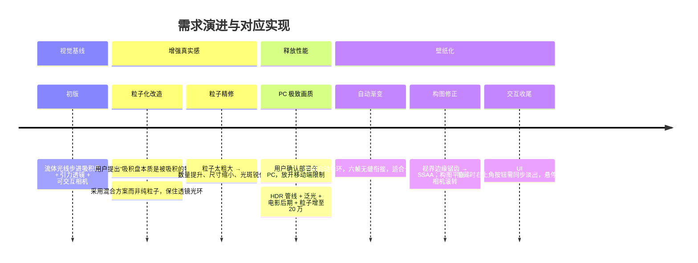
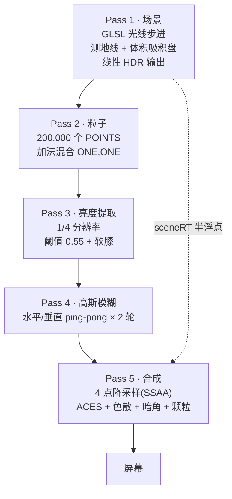

# Gargantua 3D · 广义相对论黑洞实时可视化

一个**单文件、零外部依赖**的 WebGL 黑洞渲染器。用浏览器实时计算史瓦西黑洞周围的零测地线光线偏折，叠加流体吸积盘与 20 万颗开普勒轨道粒子，走 HDR + 多级泛光的电影级渲染管线，并支持无缝色彩循环，可直接作为桌面壁纸使用。

> 打开 `index.html` 即可运行，不需要打包、不需要联网、不需要任何框架。

**[▶ 在线预览](https://blycr.github.io/blackhole-3d/)** · **[🖼 壁纸模式（无 UI）](https://blycr.github.io/blackhole-3d/?wallpaper=1)**


<p align="center"><em>自动渐变第 ④ 帧「品红」相位 · 1920×1080 实机截图</em></p>

---

## 目录

- [效果特性](#效果特性)
- [需求演进](#需求演进)
- [快速开始](#快速开始)
- [技术细节](#技术细节)
- [控制面板](#控制面板)
- [分辨率与性能策略](#分辨率与性能策略)
- [代码结构](#代码结构)
- [版本历史](#版本历史)
- [导入 Wallpaper Engine](#导入-wallpaper-engine)
- [浏览器兼容性](#浏览器兼容性)
- [已知限制](#已知限制)
- [验证方式](#验证方式)
- [许可证](#许可证)

---

## 效果特性

| 特性 | 说明 |
| :--- | :--- |
| **引力透镜** | 逐像素积分史瓦西零测地线，黑洞背面的吸积盘光线被弯曲抬升到上下两侧，形成标志性的"双层光环" |
| **事件视界阴影** | 半径 `rs = 1` 的事件视界，光线进入即被吞没，输出纯黑 |
| **光子环** | 贴近光子球（`1.36 rs`）多次绕行的光线形成细锐亮环 |
| **流体吸积盘** | 体积密度场 + 三层噪声（湍流/细节/尘埃暗带），极坐标螺旋扭曲，内圈转速更快 |
| **相对论多普勒** | 迎向观察者的一侧更亮偏冷白，背离的一侧更暗偏红橙（beaming 指数 2.2） |
| **20 万颗粒子** | 开普勒角速度螺旋内落，事件视界遮挡剔除 + 引力透镜近似偏移 |
| **HDR 渲染** | 半浮点离屏缓冲，高光不被截断到 1.0 |
| **多级泛光** | 亮度提取 + 两组可分离高斯模糊 ping-pong，吸积盘内圈真正"溢光" |
| **电影后期** | ACES 色调映射 + 径向色散 + 暗角 + 胶片颗粒 |
| **SSAA 抗锯齿** | 场景按显示分辨率的 1.2~2.0 倍渲染，合成时 4 点降采样 |
| **4 种色彩主题** | 卡冈图雅金橙 / 蓝巨星 / 深渊紫 / 自动渐变 |
| **无缝色彩循环** | 6 关键帧在 LCh 感知空间插值，首尾逐位相同，可无限循环 |
| **斜置构图** | 相机滚转 -70°~+70°，默认 -18°，避免"横平竖直"的演示图感 |
| **壁纸模式** | `?wallpaper=1` 隐藏全部 UI，纯画面输出 |

---

## 需求演进

这个项目是按需求一轮轮迭代出来的，每次改动都打了 Git 标签，可直接回退：



一次关键取舍：用户最初提出"把吸积盘全部换成粒子"。纯粒子在显卡里按直线投影绘制，会丢失引力透镜造成的上下弧光环，看起来退化成"普通发光圆盘（类似土星环）"。因此改为**流体底盘 + 粒子叠加**的混合方案，既保留物理正确的弯曲光环，又能看到一颗颗物质螺旋内落。

---

## 快速开始

### 方式零：在线直接看

- 普通模式：<https://blycr.github.io/blackhole-3d/>
- 壁纸模式：<https://blycr.github.io/blackhole-3d/?wallpaper=1>

由 GitHub Pages 托管，图形计算全部在你的显卡上完成（纯静态页面）。

### 方式一：直接打开

双击 `index.html`，所有资源都内联在这一个文件里。

### 方式二：本地 HTTP 服务（局域网共享）

```bash
# 在项目目录下
python3 -m http.server 8080
```

然后访问：

| 场景 | 地址 |
| :--- | :--- |
| 本机 | `http://localhost:8080/` |
| 局域网其他设备 | `http://<你的内网 IP>:8080/` |
| 壁纸模式（无 UI） | `http://<你的内网 IP>:8080/?wallpaper=1` |

### 方式三：壁纸模式

在 URL 后加 `?wallpaper=1`：

- 全部 UI 收起（标题、控制面板、操作提示、右上角按钮）
- 右上角按钮容器进入 `hidden` 态，`pointer-events: none`，不会误触
- 自动环绕巡航常开，画面持续缓慢旋转

---

## 技术细节

### 渲染管线总览



### 1. 光线步进：史瓦西零测地线

从相机向每个像素发射一条光线，然后按广义相对论的光子轨道方程逐步积分。

在几何单位制（`rs = 1`）下，光子在史瓦西时空中满足：

$$\frac{d^2u}{d\varphi^2} + u = \frac{3}{2}\,r_s\,u^2,\qquad u = \frac{1}{r}$$

代码用笛卡尔坐标的等价形式做半隐式欧拉积分：

$$\vec{a} = -\frac{3}{2}\,h^2\,\frac{\vec{r}}{r^5},\qquad h^2 = |\vec{r}\times\vec{v}|^2\;(\vec{r},\vec{v}\ \text{为步进起点})$$

```glsl
vec3 L = cross(pos, vel);
float h2 = dot(L, L);            // 角动量平方，沿光线守恒
// 每一步：
float r2 = r * r;
float r5 = r2 * r2 * r;
vec3 acc = -1.5 * uGravity * h2 * pos / max(r5, 0.0001);
vel = normalize(vel + acc * dt);  // 只改方向，光速恒定
```

关键实现点：

- **角动量守恒**：`h2` 只在起点算一次，之后整条光线复用，这正是轨道方程的核心不变量。
- **自适应步长**：`dt = clamp(r * 0.055, 0.022, 0.34)`，靠近黑洞自动加密；当光线进入赤道面附近（`|y| < 0.5` 且 `r < diskOuter + 0.9`）再压到 `0.045`，保证穿盘时采样密度足够。
- **终止条件**：`r < 1.005 rs` 判定被吞没；`r > 30` 且正在远离则判定逃逸，采样背景星空。
- **步数**：`STEPS = 165`。

因为光线本身被弯折，"黑洞背面那半圈盘"的光会绕过上方/下方射入观察者眼睛，于是自然出现《星际穿越》式的上下双弧——这不是画上去的，是积分出来的。

### 2. 吸积盘体积密度场

吸积盘定义在赤道面附近的薄壳内（`1.55 < r < 7.0`，厚度随半径增长）：

```glsl
float diskThickness = 0.062 + 0.030 * (r - diskInner);
float verticalFade  = exp(-pow(yDist / diskThickness, 2.0));
```

密度由四项相乘，全部在极坐标下做：

| 项 | 实现 | 作用 |
| :--- | :--- | :--- |
| 螺旋扭曲 | `swirl = atan(z,x) + t·ω(r) + 3.2/√r` | 内圈转得快，拉出螺旋臂 |
| 湍流 | `fbm(sampleCoord * 1.4)`（4 层） | 大尺度云团结构 |
| 高频细节 | `noise3(sampleCoord * 5.2)` | 气流边缘的丝状质感 |
| 尘埃暗带 | `smoothstep(0.15, 0.65, noise3(...))` | 盘面上的暗纹层次 |

角速度取开普勒式衰减：`ω(r) = 2.6 / r^1.15`。

渲染采用**前向累积**（front-to-back），每步：

```glsl
accumColor += transmittance * emitCol * intensity;
transmittance *= exp(-density * dt * 2.4);
```

`transmittance < 0.015` 时提前结束，避免无谓计算。

### 3. 相对论多普勒与 beaming

气体做切向运动，速度方向与视线方向的夹角决定色移与亮度：

```glsl
vec3 tangentVel = normalize(vec3(-pos.z, 0.0, pos.x));
float shift = dot(tangentVel, -vel) * uDoppler;
float beaming = pow(clamp(1.0 + shift * 0.55, 0.26, 2.2), 2.2);
```

- `shift > 0`：气体朝观察者运动 → 提亮 + 色温偏冷（`mix` 向白蓝）
- `shift < 0`：气体远离 → 压暗 + 色温偏红（乘 `(1.15, 0.65, 0.45)`）

指数 2.2 对应相对论 beaming 的 `δ³` 关系做了观感调校。

### 4. 粒子系统：20 万颗的开普勒内落

粒子数据只有 4 个 float（`vec4 aSeed`），运动完全在顶点着色器里算，CPU 每帧零开销：

| 分量 | 含义 |
| :--- | :--- |
| `x` | 生命周期相位种子 |
| `y` | 初始角度 |
| `z` | 垂直散布（-1~1） |
| `w` | 尺寸与呼吸相位 |

```glsl
float life = fract(aSeed.x - uTime * fallSpeed + aSeed.w * 0.17); // 递减 => 向内落
float r = mix(rMin, rMax, pow(life, 1.22));
float omega = (2.7 / pow(r, 1.2)) * uSpin;                        // 内圈更快
float angle = aSeed.y + uTime * omega + 3.5 / sqrt(r);
```

**两个关键修正**，否则粒子会"穿帮"：

1. **事件视界遮挡**：粒子投影到相机空间后，若位于黑洞后方（`zCam > bhDist`）且撞击参数 `bProj < 1.30`，直接丢弃（`gl_Position` 推到裁剪空间外）。
2. **引力透镜近似**：黑洞后方靠近边缘的粒子沿径向外推，模拟光线绕行造成的"光晕外扩"：

```glsl
float lensPush = (0.80 * uGravity) / max(bProj * bProj, 0.5);
xCam += dir2d.x * lensPush * zCam * 0.45;
```

粒子用 `gl.POINTS` + 加法混合（`ONE, ONE`）绘制，片元着色器里做高斯核 + 光晕：

```glsl
float core = exp(-d2 * 30.0);
float halo = exp(-d2 * 9.0) * 0.30;
```

### 5. HDR 管线与泛光

**为什么需要 HDR**：8bit 纹理把颜色钳制在 `[0,1]`，吸积盘内圈的亮度无法超过 1.0，泛光就提不出高光。因此启动时探测半浮点纹理：

```javascript
const extHalfFloat = gl.getExtension("OES_texture_half_float");
// 建 4×4 测试 FBO 检查完整性，不完整则回退 gl.UNSIGNED_BYTE
```

所有离屏目标统一用 `texType`，场景 Pass 输出**线性 HDR**（不做色调映射），把 tonemap 留到合成阶段。

**泛光四步**：

| 步骤 | 分辨率 | 做法 |
| :--- | :--- | :--- |
| 亮度提取 | 1/4 | 4 点盒式降采样，`w = max(lum - 0.55, 0) / lum` |
| 水平模糊 | 1/4 | 9 抽头高斯，`A → B` |
| 垂直模糊 | 1/4 | 9 抽头高斯，`B → A` |
| 二次扩散 | 1/4 | 偏移量放大到 `2.2` 像素再走一轮，光晕更宽 |

ping-pong 的每一轮都保证"读的纹理"与"写的 FBO"不是同一个，不存在反馈回路。

### 6. 合成与电影后期

```glsl
vec3 col = sceneCol + bloom * uBloomStrength;
col = acesFilm(col * uExposure);      // ACES 近似曲线
col = pow(col, vec3(1.0 / 2.2));      // 线性 -> sRGB
col *= mix(0.62, 1.0, vignette);      // 暗角
col += (hash(vUv * uRes + t) - 0.5) * 0.012;  // 胶片颗粒
```

泛光还做了轻微的**径向色散**：红/蓝通道按半径偏移采样，让光晕边缘出现一点冷暖分离，更像真实镜头。

### 7. SSAA 超采样抗锯齿

场景渲染到离屏纹理，画布的 MSAA 不生效，因此改用自己的超采样：

```javascript
// 显示分辨率有像素预算（约 900 万），超标按比例缩减
// 超采样倍率把渲染像素控制在约 1200 万以内
ssaaRatio = clamp(Math.sqrt(12.0e6 / (dw * dh)), 1.0, 2.0);
```

| 显示分辨率 | 超采样倍率 | 场景渲染像素 |
| :--- | :--- | :--- |
| 1920×1080 | 2.0× | ~8.3 M |
| 2560×1440 | 1.8× | ~12 M |
| 3840×2160 | 1.2× | ~12 M |

合成时用 4 点旋转网格做面积平均（不是模糊，是真正多点采样），同时修掉**视界边缘、光子环、星点**三处的锯齿：

```glsl
sceneCol  = texture2D(uScene, vUv + uDispTexel * vec2(-0.25, -0.25)).rgb;
sceneCol += texture2D(uScene, vUv + uDispTexel * vec2( 0.25, -0.25)).rgb;
sceneCol += texture2D(uScene, vUv + uDispTexel * vec2(-0.25,  0.25)).rgb;
sceneCol += texture2D(uScene, vUv + uDispTexel * vec2( 0.25,  0.25)).rgb;
sceneCol *= 0.25;
```

### 8. LCh 调色引擎

三种静态主题直接给颜色，第四种"自动渐变"走插值。插值**不在 RGB 空间做**——线性 RGB 插值会在两个互补色之间穿过灰区，出现发脏的死色。

改为转换到 CIELAB 再取 LCh（明度 / 彩度 / 色相），明度与彩度线性插值，色相走**最短路径**：

```javascript
function mixLch(c0, c1, t) {
  let dh = c1[2] - c0[2];
  while (dh > 180)  dh -= 360;   // 最短路径
  while (dh < -180) dh += 360;
  return [c0[0] + (c1[0] - c0[0]) * t,
          c0[1] + (c1[1] - c0[1]) * t,
          c0[2] + dh * t];
}
```

六个关键帧（暖色为主，中段穿插冷色，首尾闭合）：

| 相位 | 主题 | 特征 |
| :--- | :--- | :--- |
| 0s | ① 金橙 | 经典卡冈图雅 |
| 10s | ② 熔金 | 琥珀更亮、核心更白 |
| 20s | ③ 血赤 | 深红盘面 + 亮橙内圈 |
| 30s | ④ 品红 | 洋红霓虹感 |
| 40s | ⑤ 极光青 | 冷色插曲，青蓝盘 + 冷白核心 |
| 50s | ⑥ 暮紫 | 薰衣草紫 → 回到金橙 |

- **无缝循环**：相位 `fract(t / cycle) × 6`，关键帧首尾完全相同，循环处逐位一致，无跳变。
- **缓动**：段内用 `smoothstep` 平滑，避免关键帧处出现速度顿挫。
- **呼吸感**：叠加 ±3.5% 的极低频亮度起伏，静止画面也有生命感。

> 性能：颜色在 CPU 每帧算 3 个 `vec3` 传 uniform，GPU 侧开销为零。

### 9. 相机与斜置构图

相机用球坐标（yaw / pitch / dist）定位，再绕视线轴做滚转（roll）：

```javascript
// 绕 fwd 旋转 right 与 up，纯构图变化，不动任何物理量
const rr = [rx * cr + ux * sr, ry * cr + uy * sr, rz * cr + uz * sr];
const uu = [-rx * sr + ux * cr, -ry * sr + uy * cr, -rz * sr + uz * cr];
```

默认 `yaw = 0.45`、`pitch = 0.32`（18.3°，盘面呈现饱满椭圆）、`roll = -0.32`（-18°，对角构图）。

交互带临界阻尼平滑：`damp = 1 - exp(-dt * 9)`，拖拽不会硬切。

### 10. 自适应性能保底

只在真的吃力时才降级，绝不主动牺牲画质上限：

```javascript
if (fps < 32 && renderScale > 0.6 && downscaleCount < 3) {
  renderScale *= 0.8;      // 逐级降采样，最多 3 档
  downscaleCount++;
  computeRenderSize();
}
```

---

## 控制面板

| 控件 | 范围 | 默认 | 说明 |
| :--- | :--- | :--- | :--- |
| 吸积粒子浓度 | 0 ~ 1.8 | 1.00 | 粒子整体亮度权重，拉到 0 可单独观察纯流体盘 |
| 气体流体浓度 | 0 ~ 1.5 | 0.80 | 流体盘密度，拉到 0 则只剩粒子 |
| 泛光强度 | 0 ~ 2.5 | 1.10 | Bloom 叠加权重 |
| 画面倾斜 | -70° ~ 70° | -18° | 相机滚转 |
| 引力弯曲强度 | 0.2 ~ 1.8 | 1.00 | 测地线加速度系数，1.0 为物理正确值 |
| 吸积盘转速 | 0 ~ 3.0 | 1.00× | 同时影响流体与粒子角速度 |
| 多普勒亮暗偏移 | 0 ~ 1.2 | 0.75 | 0 为关闭相对论效应 |
| 吸积盘色温 | 4 选 1 | 卡冈图雅 | 三个静态主题 + 自动渐变 |
| 色彩循环周期 | 20 ~ 300s | 60s | 仅自动渐变模式生效 |
| 自动环绕巡航 | 开/关 | 开 | 相机缓慢自转 |

**其它交互**：左键/单指拖拽旋转，滚轮/双指缩放（3.6 ~ 22.0），`重置视角` 恢复默认机位，`隐藏 UI` 收起全部界面（右上角按钮随之下淡，鼠标移到右上角热区再浮现）。

---

## 分辨率与性能策略

| 策略 | 参数 | 位置 |
| :--- | :--- | :--- |
| DPR 上限 | 2.0 | `computeRenderSize()` |
| 显示像素预算 | 9.0 M（约 4K） | `BUDGET` |
| 超采样像素预算 | 12.0 M | `ssaaRatio` |
| 光线步数 | 165 | `STEPS` |
| 粒子数 | 200,000 | `PARTICLE_COUNT` |
| 泛光分辨率 | 显示分辨率的 1/4 | `createTargets()` |
| 降级触发 | `fps < 32` | 渲染循环尾部 |

估算：1080p 下单帧场景 Pass 约 830 万像素 × 165 步，属于桌面独显可流畅承担的量级；集显建议先看面板右上角的实时 FPS，低于 32 会自动降采样。

---

## 代码结构

单文件 `index.html`，按注释分节：

```
index.html
├── <style>            毛玻璃 UI、滑块、开关、响应式断点
├── <canvas>           全屏渲染目标
├── HUD               标题、右上角按钮、操作提示
├── 控制面板          10 个控件
└── <script>
    ├── 0.  HDR 能力探测（半浮点纹理 + FBO 完整性检查）
    ├── 1.  全屏四边形与通用顶点着色器
    ├── 2.  FS_SCENE      测地线光线步进 + 体积吸积盘
    ├── 3.  VS/FS_PARTICLE 开普勒粒子、视界遮挡、透镜近似
    ├── 4.  FS_BRIGHT / FS_BLUR  泛光提取与模糊
    ├── 5.  FS_COMPOSITE  SSAA 降采样 + ACES + 后期
    ├── 6.  着色器编译与程序构建
    ├── 7.  粒子缓冲区（20 万 × vec4）
    ├── 8.  渲染目标管理与尺寸计算
    ├── 9.  相机状态与鼠标/触控交互
    ├── 10. UI 绑定、壁纸模式、空闲淡出
    ├── 11. 工具函数（相机矩阵、全屏绘制）
    ├── 11.5 调色引擎（Lab/LCh 转换、关键帧插值）
    └── 12. 渲染循环（5 个 Pass + FPS 统计）
```

---

## 版本历史

每个阶段都打了标签，可随时回退：

```bash
git tag -l
git reset --hard v1.1-auto-gradient   # 例如回退到自动渐变版
```

| 标签 | 提交 | 内容 |
| :--- | :--- | :--- |
| `v1.4-star-fix` | — | 修复星点被网格边界裁成短线（光斑限制在单元内） |
| `v1.3-exposure-tune` | — | 内圈降饱和降亮度、泛光阈值 0.75、曝光 1.00、环纹幅度收窄 |
| `v1.2-ssaa-tilt` | `e08f065` | SSAA 抗锯齿修复视界锯齿；相机滚转斜置构图 |
| `v1.1-auto-gradient` | `d209cc8` | LCh 六关键帧自动渐变；壁纸模式；UI 空闲淡出 |
| `v1.0-hdr-ultra` | `c5e4c58` | HDR 管线 + 多级泛光 + 电影后期；粒子增至 20 万 |
| `v0.2-25k-particles` | `e34a6ee` | 粒子变细小、数量 25,000（移动端友好） |
| — | `626a067` | 混合方案首版：流体 + 5,000 粒子 |
| — | `8200312` | 初始版：纯流体光线步进 |

后续未打标签的修复：`89981e6`（UI 隐藏时右上角按钮同步淡出，悬停热区唤出）。

---

## 导入 Wallpaper Engine

1. 复制 `index.html` 到本机（单文件，无依赖）。
2. Wallpaper Engine → 左下「创建壁纸」→ 选择 **Web / 网页**。
3. 指向该 `index.html`；或填局域网地址 `http://<内网 IP>:8080/?wallpaper=1`。
4. 在壁纸属性里建议：关闭鼠标输入、关闭音频、缩放模式选「填充」。

`?wallpaper=1` 会隐藏全部 UI，保证纯画面输出。

---

## 浏览器兼容性

- 需要 **WebGL 1.0**（`OES_texture_half_float` 可选，缺失时自动回退 8bit，泛光效果略弱但不报错）。
- 推荐 Edge / Chrome / Firefox 最新版。
- 移动端可运行，但 20 万粒子 + 超采样对手机 GPU 压力较大，会自动降级。

---

## 已知限制

1. **仅史瓦西黑洞**：没有自转角动量，因此没有 Kerr 黑洞的拖曳效应（frame dragging）和非对称阴影。
2. **粒子透镜为近似**：粒子在透视投影后用径向外推模拟偏折，不是真实测地线积分（真实积分需要逐粒子追踪，成本过高）。暗色背景下观感一致，极近景可能有细微偏差。
3. **多普勒为观感调校**：`beaming` 指数与色移幅度经过美术调整，不是严格的光度学计算。
4. **单盘假设**：只有赤道面一层吸积盘，没有喷流（jet）与吸积柱。
5. **画面镜像**：相机基向量采用 `right = cross(fwd, up)`，行列式为 -1，画面水平镜像。对轴对称的黑洞场景无视觉影响。
6. **亮度为美术平衡值**：内圈色温、beaming 指数、泛光阈值与曝光共同决定最终亮度，当前取值以"保留环纹细节、不烧白"为目标，非光度学严格值。

---

## 验证方式

本项目在无 GPU 的沙盒环境中完成，因此采用可自动化的方式验证：

```bash
# 1. 着色器真实编译（ESSL 1.00），7 个着色器全部通过
glslangValidator -S frag scene.frag

# 2. JavaScript 语法检查
bun build script.js --target=browser --outfile=/dev/null

# 3. 调色引擎数值测试
#    11 个采样点：0 个 NaN、0 个负值；首尾色差 0.0000（无缝循环成立）

# 4. 相机矩阵正交性
#    三种滚转角下正交误差 ~3.9e-8，行列式恒定 -1.0000
```

> 说明：这些检查保证**代码可编译、数学自洽、逻辑无回归**，最终视觉效果需在具备 GPU 的浏览器中确认。

---

## 许可证

[MIT](LICENSE) © 2026 blycr

可自由使用、修改、分发，包括商业用途，保留版权声明即可。

---

## 仓库结构

```
blackhole-3d/
├── index.html    # 全部实现（HTML + CSS + GLSL + JS，单文件零依赖）
├── README.md     # 本文档
├── LICENSE       # MIT
├── .gitignore
├── .nojekyll       # 关闭 Jekyll 处理，纯静态托管
└── docs/
    └── preview.jpg  # 预览截图
```
